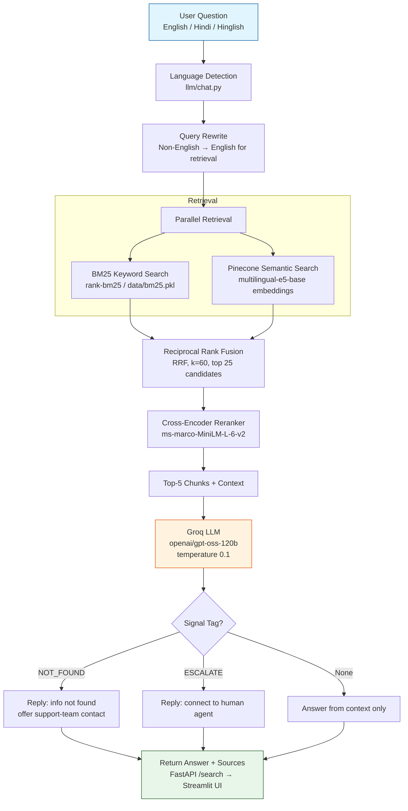

# CarePal RAG Chatbot

> Hybrid retrieval-augmented chatbot over scraped **thecarepal.com** pages (elderly care, home nursing, doctor and therapy services): BM25 + Pinecone semantic search, Reciprocal Rank Fusion, cross-encoder reranking, and Groq answer generation — with multilingual support (English / Hindi / Hinglish).

---

## Table of Contents

- [About the Project](#about-the-project)
- [Tech Stack](#tech-stack)
- [Project Structure](#project-structure)
- [Key Design Decisions](#key-design-decisions)
- [System Flowchart](#system-flowchart)
- [Setup & Installation](#setup--installation)
- [Usage](#usage)
- [API Reference](#api-reference)
- [Chunking Strategy](#chunking-strategy)
- [Evaluation](#evaluation)
- [Future Scope](#future-scope)
- [Environment Variables](#environment-variables)
- [License](#license)

---

## About the Project

**CarePal RAG Chatbot** answers user questions about elder care, home nursing, doctor and therapy services using only content scraped from `thecarepal.com`. It is a **Retrieval-Augmented Generation (RAG)** system that:

1. Receives a user question (English, Hindi in Devanagari, or Hinglish).
2. Retrieves relevant chunks through **hybrid search** — BM25 (keyword) and Pinecone (semantic/vector).
3. Fuses results with **Reciprocal Rank Fusion (RRF)** and reranks with a **cross-encoder**.
4. Passes the top chunks as context to a **Groq LLM** (`openai/gpt-oss-120b`), which answers strictly from that context.
5. Returns the answer with source URLs, plus graceful handling for "not found" and human-handoff cases.

Two interfaces are provided:
- **CLI** (`main.py`) — terminal chatbot for quick testing.
- **FastAPI** (`app.py`) — REST API (`/search`, `/health`) backed by a **Streamlit** frontend (`streamlit_app.py`).

---

## Tech Stack

| Layer | Technology |
|-------|------------|
| **LLM** | Groq — `openai/gpt-oss-120b` (temperature 0.1) |
| **Vector DB** | Pinecone (cosine similarity, 768-dim) |
| **Embedding** | `intfloat/multilingual-e5-base` (512-token limit) |
| **Keyword Search** | `rank-bm25` (BM25Okapi) |
| **Reranking** | `cross-encoder/ms-marco-MiniLM-L-6-v2` |
| **Web Framework** | FastAPI + Uvicorn |
| **Frontend** | Streamlit |
| **Language** | Python 3.10+ |
| **Config** | `python-dotenv` |

---

## AI Tools & Costs

### AI tools used during development

| Tool | Used for |
|------|----------|
| LLM coding assistant | Writing and reviewing code, drafting the README, generating the Mermaid flowchart, and explaining design decisions. All code was reviewed, tested, and understood before submission. |

### Cost to run each library / model

| Library / Model | Purpose | Pricing model | Approx. cost |
|-----------------|---------|---------------|--------------|
| **Groq** — `openai/gpt-oss-120b` | Answer generation | Pay-per-token (Groq has a free tier; paid beyond free limits) | Free tier available; paid usage is per million tokens |
| **Pinecone** | Vector storage & semantic search | Free Starter tier (limited index size & pods); paid plans beyond that | Free Starter tier; paid scales with index size |
| **`intfloat/multilingual-e5-base`** | Embeddings | Open model, self-hosted on CPU via `sentence-transformers` | Free (no API cost; runs on your hardware) |
| **`cross-encoder/ms-marco-MiniLM-L-6-v2`** | Reranking | Open model, self-hosted on CPU | Free (no API cost; runs on your hardware) |
| **`rank-bm25`** | Keyword search | Open-source library | Free |
| **FastAPI / Uvicorn / Streamlit** | Web server + frontend | Open-source | Free |
| **LangChain packages** (`langchain-groq`, `langchain-core`, `langchain-pinecone`, `langchain-huggingface`) | LLM / vector-store integrations | Open-source | Free |

**Bottom line:** The project can run entirely on free tiers (Groq free tier + Pinecone Starter + self-hosted embeddings/reranker on CPU). You only pay if you exceed Groq's free token allowance or Pinecone's Starter index limits.

---

## Project Structure

```
care_assign/
├── app.py                 # FastAPI server  (POST /search, GET /health)
├── main.py                # CLI chatbot
├── ingest.py              # Build KB: chunks → Pinecone vectors + BM25 index
├── create.py              # One-off Pinecone index creation (768-dim, cosine)
├── reranker.py            # Cross-encoder reranker
├── config.py              # Config & env loader (chunk sizes, top-k)
├── CHUNKING.md            # Chunking strategy + benchmark rationale
├── streamlit_app.py       # Streamlit UI frontend (chat + support form)
├── .env.example           # Environment variable template
├── .env                   # Local secrets (gitignored)
├── requirements.txt       # Python dependencies
├── data/
│   ├── cleaned_pages.json # Scraped CarePal pages (31 pages, ~113k chars)
│   └── bm25.pkl           # Serialised BM25 index (created by ingest.py)
├── llm/
│   └── chat.py            # Groq prompt, answer gen, language detection
├── pro/
│   ├── keyword_based.py   # BM25 keyword search
│   ├── semantic.py        # Pinecone semantic/vector search
│   └── hybrid.py          # CombinedSearch (RRF fusion + reranking)
└── ingestion/
    ├── json_loader.py     # Loads cleaned_pages.json → LangChain Documents
    ├── chunker.py         # Structure-aware chunking (heading-based)
    ├── embedder.py        # HuggingFace embedding model wrapper
    ├── pdf_loader.py      # PDF loader utility (unused for current data)
    └── pinecone_upload.py # Uploads chunks to Pinecone
```

---

## Key Design Decisions

### 1. Structure-aware chunking over fixed-size or semantic chunking
Six chunking strategies were benchmarked on 33 gold questions (hit@3 / MRR). The chosen **structure-aware** approach (Strategy F) split pages on Markdown headings, packed small neighbouring sections, and recursively split only oversize sections — keeping every chunk under ~1200 chars (~300 tokens) so it fits inside the 512-token limit of the embedder and reranker.

| Metric | Fixed 700 | Fixed 1200 | Whole page | Semantic | Header-only | **Structure-aware (chosen)** |
|--------|-----------|------------|------------|----------|-------------|------------------------------|
| Chunks | 247 | 145 | 31 | 291 | 283 | **187** |
| Avg chars | 495 | 805 | 3,662 | 388 | 400 | **705** |
| Hit@3 | 0.79 | 0.79 | 0.94 | 0.73 | 0.73 | **0.85** |
| MRR | 0.70 | 0.74 | 0.87 | 0.59 | 0.63 | **0.79** |

Whole-page chunking only "won" because keyword search easily matches at page level; in production the embedding model and cross-encoder truncate at ~512 tokens, so most page text would be invisible. Semantic chunking was unstable on short FAQ-style text and required per-sentence embedding calls at ingest time.

**Reference:** `ingestion/chunker.py`, `CHUNKING.md`.

### 2. Hybrid retrieval (BM25 + Pinecone) with RRF fusion
Neither keyword nor semantic search alone is sufficient:
- **BM25** excels at exact-term matches (service names, phone numbers, eligibility criteria).
- **Pinecone semantic search** captures paraphrased intent ("how do I book a nurse for my father?").

`pro/hybrid.py` fetches `top_n × 5` candidates from each, fuses them with **Reciprocal Rank Fusion** (`1 / (k + rank)`, `k = 60`), takes the top 25, then reranks.

### 3. Cross-encoder reranking after RRF
RRF brings up a diverse candidate set; the **`cross-encoder/ms-marco-MiniLM-L-6-v2`** cross-encoder scores each (query, document) pair jointly and re-orders to the final top-5. This significantly improves precision over raw vector or BM25 scores alone.

### 4. Multilingual support (English / Hindi / Hinglish)
The system detects the user's language and:
- Rewrites non-English queries to English for retrieval (`llm/chat.py` `rewrite_query`).
- Instructs the Groq LLM to reply in the **same language** as the user, keeping service names, prices, phone numbers and URLs verbatim.

Language detection: Devanagari script → Hindi; Roman Hindi keywords → Hinglish; otherwise English.

### 5. Deterministic signal tags instead of free-form refusal
The LLM prompt uses two explicit tags on the last line only:
- `[[NOT_FOUND]]` — when the context doesn't contain the answer; the app offers to connect the user to the support team without asking for PII yet.
- `[[ESCALATE]]` — when the user asks for a human/agent/callback.

These tags are parsed in `llm/chat.py` (`generate_answer_ex`) so the UI can render fallback messages and trigger the support form reliably.

### 6. Chunk size capped at ~1200 chars (~300 tokens)
The embedding model (`multilingual-e5-base`) and the cross-encoder reranker both truncate at 512 tokens (~2,000 chars). A 1200-char chunk gives headroom while keeping 5 chunks (~3.5k chars) as a cheap LLM context. Configurable via `config.py` (`MAX_CHUNK_CHARS`, `MIN_CHUNK_CHARS`, `CHUNK_OVERLAP`).

---

## System Flowchart



**Flow summary:**
1. User asks a question via CLI, FastAPI `/search`, or Streamlit UI.
2. The question is language-detected and, if needed, rewritten to English for retrieval.
3. BM25 and Pinecone retrieve candidates in parallel.
4. Results are fused with RRF and reranked by a cross-encoder to the top 5 chunks.
5. The top chunks form the context for the Groq LLM, which answers strictly from that context in the user's language.
6. The answer is returned with source URLs; `[[NOT_FOUND]]` / `[[ESCALATE]]` tags trigger graceful fallbacks.

---

## Setup & Installation

### Prerequisites
- Python 3.10+
- A Pinecone account with an index (768 dimensions, cosine metric)
- A Groq API key

### 1. Clone and install dependencies

```bash
git clone <repo-url>
cd care_assign
pip install -r requirements.txt
```

### 2. Configure environment variables

Copy `.env.example` to `.env` and fill in your credentials:

```bash
cp .env.example .env
```

```ini
PINECONE_API_KEY=your-pinecone-api-key
PINECONE_INDEX=your-pinecone-index-name
GROQ_API_KEY=your-groq-api-key
```

### 3. Create the Pinecone index (one-time)

```bash
python create.py
```

This creates a serverless index named `carepal-rag` (768-dim, cosine, AWS us-east-1). Change `create.py` if you want a different name/region.

### 4. Build the knowledge base (required before first run)

```bash
python ingest.py --reset
```

This:
1. Loads `data/cleaned_pages.json` (31 scraped pages).
2. Runs structure-aware chunking → 187 chunks.
3. Uploads vectors to Pinecone.
4. Serialises the BM25 index to `data/bm25.pkl`.

Use `--reset` when re-ingesting after changing the chunker or data, so stale vectors are cleared first.

---

## Usage

### CLI chatbot

```bash
python main.py
```
Type `exit` to quit.

### FastAPI server

```bash
python app.py
# http://localhost:8000
```

```bash
curl http://localhost:8000/health

curl -X POST http://localhost:8000/search \
  -H "Content-Type: application/json" \
  -d '{"query": "What are the eligibility criteria for a business loan?"}'
```

Response:
```json
{
  "answer": "...",
  "chunks": [{"text": "...", "score": 0.85}, ...],
  "sources": ["https://thecarepal.com/..."]
}
```

Interactive docs: `http://localhost:8000/docs`

### Streamlit frontend

```bash
streamlit run streamlit_app.py
```
Point the sidebar "Backend URL" at your running FastAPI server (`http://localhost:8000`).

---

## API Reference

### `POST /search`
**Request:** `{ "query": "<question>" }`  
**Response:** `{ "answer": "<str>", "chunks": [{"text": "<str>", "score": <float>}], "sources": ["<url>", ...] }`

### `GET /health`
**Response:** `{ "status": "ok" }`

### Python modules

| Module | Class / Function | Purpose |
|--------|------------------|---------|
| `pro.keyword_based` | `KeywordSearchBM25(documents).search(query, top_n)` | BM25 keyword retrieval |
| `pro.semantic` | `SemanticSearch().search(query, top_n)` | Pinecone vector retrieval |
| `pro.hybrid` | `CombinedSearch(kw, vec).search(query, top_n)` | RRF fusion + cross-encoder rerank |
| `reranker` | `CrossEncoderReranker().rerank(query, docs, top_n)` | Cross-encoder reranking |
| `llm.chat` | `generate_answer(question, context)` | Groq answer generation |
| `ingestion.chunker` | `chunk_documents(documents)` | Structure-aware chunking |
| `ingestion.pinecone_upload` | `upload(chunks, reset)` | Pinecone upsert |

---

## Chunking Strategy

Full rationale and benchmark numbers are in **`CHUNKING.md`**. Summary:

1. **Clean** scraping noise (icon links, social headings, empty headings, `0` counters, duplicated carousel blocks).
2. **Split on Markdown headings**, keeping the heading breadcrumb (`Page > Section > Subsection`).
3. **Pack** neighbouring small sections (< 300 chars) together up to a 1200-char cap.
4. **Split only oversize sections** recursively (paragraph → bullet → line → sentence → word), 150-char overlap, repeating the section heading.
5. **Prefix every chunk** with `Page: <title>` / `Section: ...` and store metadata (`url`, `title`, `category`, `section`, `chunk_index`, `chunk_id`).
6. **Skip** pages < 200 chars after cleaning (e.g. the Sign-in page).

Result: 187 chunks, 160–1,358 chars, 0 noise chunks, 0 duplicates, 0 fragments < 150 chars.

---

## Evaluation

A sanity benchmark of 33 gold questions (written from the same data) was used to compare chunking strategies. It is **not** a held-out test set; treat it as a design sanity check. For production, we recommend building a held-out evaluation set and measuring:
- Hit@K / MRR for retrieval
- Faithfulness and answer relevance for generation
- Language-accuracy for Hindi/Hinglish responses

See `CHUNKING.md` limitations for details.

---

## Future Scope

### 1. Caching Strategy (high priority)
Introduce a **two-tier caching layer** to reduce latency, LLM cost, and Pinecone load:

| Cache Layer | What it stores | TTL / Invalidation | Tech |
|-------------|---------------|--------------------|------|
| **Exact-query cache** | Full LLM answer for exact question strings | 24h; invalidated on re-ingest | Redis / disk cache (`cachetools`) |
| **Semantic cache** | Answers for near-identical questions (cosine similarity > 0.95 on query embeddings) | 24h | Redis + `multilingual-e5-base` embeddings |
| **Chunk/retrieval cache** | Top-k chunks per query embedding | 7d | Redis |

**Implementation sketch** (`app.py` / `llm/chat.py`):
```python
query_embedding = embedder.embed_query(query)
cached = semantic_cache.get(query_embedding, threshold=0.95)
if cached:
    return cached
answer = generate_answer(query, context)
semantic_cache.set(query_embedding, answer, ttl=86400)
```

Expected benefits: 40–70% reduction in Groq token cost and Pinecone queries for repeat questions; sub-100ms responses for cached hits.

### 2. Query rewriting & expansion
- Multi-query expansion (generate 2–3 paraphrases, retrieve for each, fuse).
- HyDE (Hypothetical Document Embeddings) for semantic retrieval.

### 3. Evaluation harness
- Held-out test set with gold answers.
- Automated metrics: hit@K, MRR, faithfulness, answer relevance, BLEU/ROUGE vs reference.
- A/B testing UI for chunk-size and reranker experiments.

### 4. User feedback loop
- Thumbs up/down on answers; store (query, chunk, answer, feedback) for future fine-tuning or reranker calibration.

### 5. Ingestion automation
- Scheduled re-scraping of `thecarepal.com` (daily/weekly) with change detection; incremental Pinecone upserts instead of full reset.
- Document versioning and chunk hash-based deduplication.

### 6. Observability
- Request tracing (OpenTelemetry/LangSmith) for retrieval → generation latency.
- Logging of `[[NOT_FOUND]]` / `[[ESCALATE]]` frequency to identify content gaps.

### 7. Frontend enhancements
- Persist chat history to a database (PostgreSQL).
- Support-form submission wired to a real backend endpoint (`save_support_request` is currently a stub in `streamlit_app.py`).
- Citations with clickable links and chunk score transparency.

---

## Environment Variables

| Variable | Required | Description |
|----------|----------|-------------|
| `PINECONE_API_KEY` | Yes | Pinecone API key |
| `PINECONE_INDEX` | Yes | Pinecone index name |
| `GROQ_API_KEY` | Yes | Groq API key |
| `CAREPAL_API_URL` | No | Streamlit → FastAPI backend URL (default `http://localhost:8000`) |

---

## License

MIT License. See `LICENSE` if applicable.

---

**Built for CarePal** — elder care, home nursing, doctor and therapy services support assistant.
